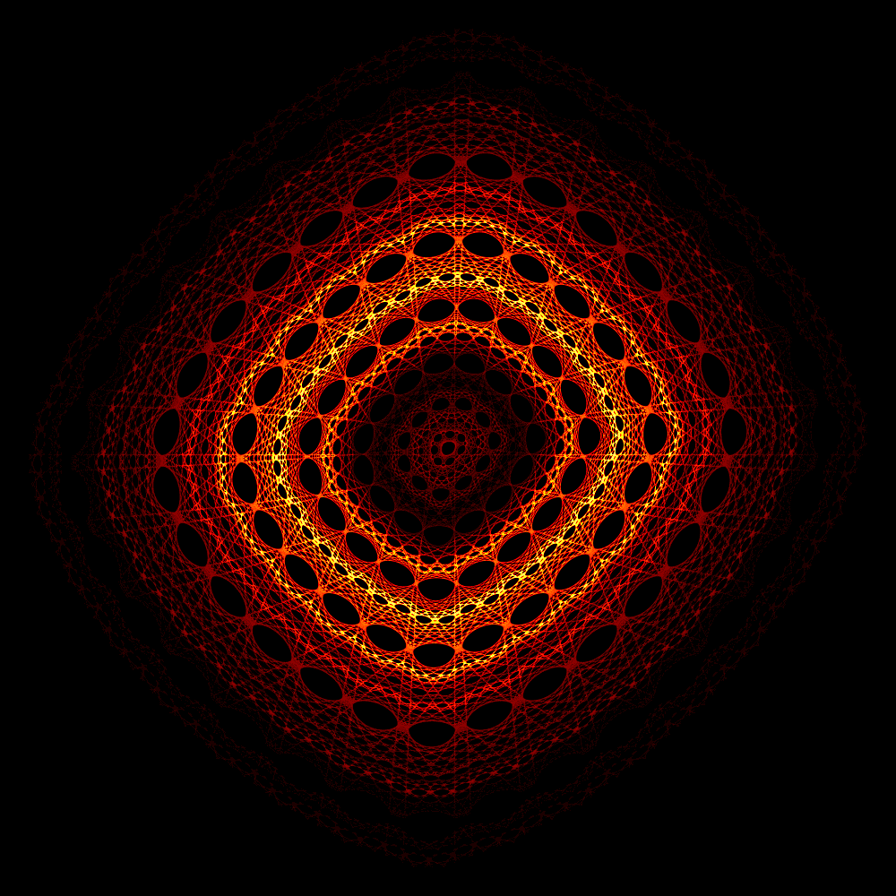

<!-- markdownlint-disable MD033 -->
# Calculate & Visualize the Hopalong Attractor with Rust



## Abstract

### Historical Context

The "*Hopalong*"<sup>*</sup> attractor, authored by Barry Martin of Aston University in Birmingham, England [[2](#references)],  
was popularized by A.K. Dewdney in the September 1986 issue of *Scientific American*. It gained further notoriety in Germany through an algorithm called *“HÜPFER”* in *Spektrum der Wissenschaft* [[3](#references)].  
<sub>*Nicknamed by A.K. Dewdney.</sub>

### The Hopalong Attractor Functions

This Rust program computes and visualizes the “hopalong” attractor by iterating the following system of recursive functions:

$$
\large
\begin{cases}
x_{n+1} = y_n - \text{sgn}(x_n) \sqrt{\lvert b x_n - c \rvert} \\
y_{n+1} = a - x_n
\end{cases}
\large
$$

Where:

- The sequence starts from the initial point (x<sub>0</sub> , y<sub>0</sub>) = (0 , 0)
- x<sub>n</sub> and y<sub>n</sub> represent the coordinates at the n-th iteration
- a, b, and c are parameters influencing the attractor's dynamics
- *sgn* is the *signum* function. The code uses Rust's standard
  [`f64::signum`](https://doc.rust-lang.org/std/primitive.f64.html#method.signum), which returns +1.0 for +0.0
  and -1.0 for -0.0, so sgn(0) = +1 in this implementation (rather than 0)

### Features and Further Information

- The image is 1000 × 1000 pixels. The orbit is scaled to fill 95 % of the canvas and centered; the y axis has the
  same orientation as in the Julia and Python versions.
- The color scheme is based on the pixel density, i.e. how often a pixel of the image is hit during the iteration.
  The hit counts are mapped, relative to the highest hit count of the image, onto a 28-step palette running from
  black through dark red, red, orange and yellow to white, so the most frequently hit pixel is always white.
  Three mappings are available: `linear` (default; proportional to the hit count), `sqrt` (square root, lifts
  rarely visited regions) and `log` (logarithm, the strongest lift, shows even single hits).
- The orbit is scaled so that its full extent fits the canvas. For some parameter sets (for example
  `-2 -0.33 0.01`) the orbit slowly spreads out, so its extent keeps growing with `num` and the picture zooms out
  accordingly. With `linear` the sparsely visited outer regions are almost black; `sqrt` or `log` makes them visible.
- The calculation uses all available CPU cores (see [Implementation Notes](#implementation-notes)).

For more information in general and about “pixel density”, i.e. displaying the attractor as a density heatmap, see my Python versions repository.

<https://github.com/ratwolfzero/hopalong_python>

## Usage

You can run this program from the command line in a terminal:

```text
./hopalong <a> <b> <c> <num> [linear|sqrt|log]
```

Examples (macOS): `./hopalong -2 -0.33 0.01 2e8` and `./hopalong -2 -0.33 0.01 2e8 sqrt`

- `a`, `b`, `c` are the parameters of the attractor (any floating-point numbers, negative values are fine).
- `num` is the number of iterations. It can be entered as an integer or in exponential form such as `1e6`, must be
  at least 1, and has no practical upper limit. The run time grows linearly with `num`.
- `linear`, `sqrt` or `log` (optional) selects the color scale described above; the default is `linear`.

While the program is running it prints the time spent in the two calculation passes (see below). Afterwards the
image is shown in a window; press <kbd>Esc</kbd> or close the window to quit.

### Saving the image

The image is also saved as a PNG named `num=<num>_a=<a>_b=<b>_c=<c>.png` (with `num` as typed, e.g.
`num=2e8_a=-2_b=-0.33_c=0.01.png`; for `sqrt` and `log` the scale is appended, e.g.
`num=2e8_a=-2_b=-0.33_c=0.01_sqrt.png`) in the folder given by the constant `OUTPUT_DIR` near the top of
`src/main.rs`:

```rust
const OUTPUT_DIR: &str = "/Users/ralf/Projects/hopalong_pictures";
```

Set it to a folder of your choice before building. The folder is created if it does not exist. If it cannot be
created or the image cannot be written, an error message is printed and the image is still displayed. Likewise, if
no window can be opened (for example in an SSH session), the image is still saved.

### Pre-built binary

If you are using a Mac with Apple Silicon you should be able to use the executable in the 'Binary' folder.  
The binary was compiled on a Mac Mini with M2 processor and uses the `OUTPUT_DIR` shown above, so on another
machine the image is displayed but saving it fails with an error message. To save images, build from source with
your own `OUTPUT_DIR`.

## Building from Source

The program needs a current stable [Rust toolchain](https://www.rust-lang.org/tools/install). The dependencies are
[`image`](https://crates.io/crates/image) (PNG output), [`minifb`](https://crates.io/crates/minifb) (window) and
[`rayon`](https://crates.io/crates/rayon) (parallelism); see `Cargo.toml` for the versions. For the best
performance enable link-time optimization in `Cargo.toml`:

```toml
[profile.release]
lto = "fat"
codegen-units = 1
```

and build with:

```text
cargo build --release
```

The executable is then `target/release/hopalong`. When building for your own x86 machine only, you can
additionally use `RUSTFLAGS="-C target-cpu=native" cargo build --release`; the resulting binary may not run on
older CPUs, so do not use this for a binary you want to share.

## Implementation Notes

The picture can only be drawn once the extent of the whole orbit is known, because the orbit is scaled to fit the
canvas. At the same time every point depends on the previous one, so the iteration itself is a serial chain (each
step needs a square root of the previous result) that cannot be split across cores. The program therefore works
in two passes and maps the continuous points directly onto a discrete grid:

1. **Pass 1 (serial).** The orbit is iterated once. The program keeps track of the minimum and maximum of x and y
   (the starting point is included) and, in addition, records the state (x, y) at the start of a number of evenly
   sized segments of the orbit (checkpoints).
2. **Pass 2 (parallel).** Starting from the checkpoints, the segments are replayed independently of each other
   with [rayon](https://crates.io/crates/rayon). Every point is mapped onto the pixel grid with the bounds from
   pass 1 and counted in a density histogram. Each task has its own histogram, so no locking is needed; the
   histograms are summed at the end. Within a task, four consecutive segments are advanced in lock-step, which
   lets the CPU overlap the latency of the square roots of the independent chains.

Because the iteration is deterministic and every segment starts from the exact state the sequential orbit has at
that point, the replay visits exactly the same points as a single sequential run, and counting is independent of
the order, so the image does not depend on the number of threads.

- **Why not simply run several orbits from different starting points?** The map is area-preserving (its Jacobian
  determinant is 1), so different starting points can end up in different invariant regions. The result would
  generally be a different picture than the orbit starting at (0, 0).
- **Counters.** Each task counts with 32-bit counters (small and cache-friendly) and is limited to 2<sup>31</sup>
  points, which makes overflow impossible; the totals are accumulated in 64-bit counters, so `num` is not limited
  by the counter size.
- **Memory.** The memory use does not depend on `num`; it is a few megabytes per thread.
- **Run time.** Pass 1 is serial and therefore sets the lower bound of the run time, which grows linearly with
  `num`. Pass 2 scales with the number of cores.

----------------------------------------------------------------------------------------------------------------------------------------------------

## References

[1]  
**J. Lansdown and R. A. Earnshaw (eds.)**, *Computers in Art, Design and Animation*.  
 New York: Springer-Verlag, 1989.  
 e-ISBN-13: 978-1-4612-4538-4.  

[2]  
**Barry Martin**, "Graphic Potential of Recursive Functions," in *Computers in Art, Design and Animation* [1],  
pp. 109–129.

[3]  
**A.K. Dewdney**, *Psychotapeten*, Algorithm *"HÜPFER"*, in *Spektrum der Wissenschaft: Computer Kurzweil*.  
Spektrum der Wissenschaft Verlagsgesellschaft mbH & Co., Heidelberg, 1988.  
(German version of *Scientific American*).  
ISBN-10: 3922508502, ISBN-13: 978-3922508502.
